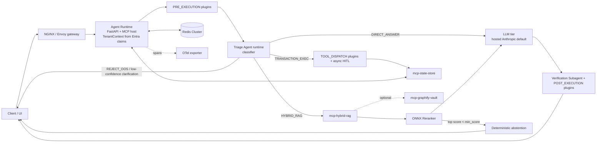

# design.md — PwC One Assistant Platform Guide

Design and configuration guide for **PwC One Assistant**, an enterprise-grade, MCP-based AI assistant, written so the same blueprint can be reused for other AI products (replace the product name and the other project variables). Copy it into a new project, fill in **Project variables**, and delete sections you don't use. Status: **design / proposed** (no code yet). Figures marked *proposed* are engineering targets to be validated by pilot and scale tests, not measured results.

Deep-dive references (read when relevant):
- @docs/system-spec.md — charter, contracts, state machines, latency, 36-KPI matrix, FMEA, persistence/PII, ADRs
- @docs/rag-metrics-catalog.md — 50 RAG hyperparameters/metrics and KPI selection by use case
- @docs/golden-dataset.md — golden-set generator prompt, schema, distribution, quality controls
- @docs/token-optimization.md — Obsidian vault + optional Graphify subgraph pruning
- @docs/dev-workbench.md — six-tab Streamlit developer workbench
- @docs/loadtest-and-security.md — load/soak/isolation tests (k6, JMeter), OWASP LLM Top 10, red teaming, Azure auth
- @docs/workflow-diagram.md — request workflow diagrams (Mermaid is the source of truth)

## Project variables

| Variable | Value |
|---|---|
| `<PRODUCT>` | **PwC One Assistant** (service name / default `SERVICE_NAME`: `pwc-one-assistant`) |
| `<DOMAIN_TOOLS>` | read tools (`TIER_1_READ`), compute tools (`TIER_2_COMPUTE`) and write tools (`TIER_3_MUTATE`) the agent may call |
| `<TENANTS>` | tenant model (single / multi) and isolation key |
| `<SLOs>` | route-specific latency targets, error rate, throughput |
| `<MODEL_TIERS>` | small (default) / large (fallback) model names for the selected provider; exact names are configuration, not architecture |
| `<KPI_PROFILE>` | one of the use-case profiles in `docs/rag-metrics-catalog.md` |

## Principles

- Every tool integration is an **MCP server** (JSON-RPC 2.0). `stdio` for local workers, **Streamable HTTP/SSE** for distributed services.
- Safety and reliability rules live in **plugins** (deterministic code), never only in prompts.
- **Fail closed**: if a safety plugin errors, block the request.
- **Least privilege**: every tool has a permission tier; writes need state checks, critical writes need human approval.
- **Ground every answer** in retrieved evidence; abstain when evidence is insufficient.
- **Measure everything**: every request emits spans and KPIs; changes ship only if the golden set doesn't regress.
- **Hosted Anthropic inference is the default**; self-hosted inference is an optional deployment profile.
- **Hybrid RAG is the correctness path**; Graphify is an optional token/context optimization.
- Hard boundary: no autonomous clinical, financial or legal execution without human-in-the-loop approval.

## Architecture



| Layer / Capability | Selected Tool / Protocol | MCP Server / Plugin Binding | Architectural Justification |
|---|---|---|---|
| Agent Runtime & API | Python 3.11 + FastAPI + Uvicorn (async) | MCP Host Client (`mcp.ClientSession`) | Non-blocking async I/O capable of sustaining 50,000 concurrent connections. |
| Sparse & Dense Retrieval | Rank-BM25 + FAISS HNSW + BGE-Large | MCP Server: `mcp-hybrid-rag` (Resources + Tools) | Exposes `rag://chunks/{id}` resources and `hybrid_retrieve` tool over JSON-RPC. |
| Precision Reranker | ONNX Runtime (`bge-reranker-v2-m3` FP16) | In-process Triton / ONNX microservice | Sub-35 ms cross-encoder inference via INT8/FP16 quantization and dynamic batching. |
| State & Session Cache | PostgreSQL (pgvector) + Redis Cluster | MCP Server: `mcp-state-store` | ACID long-term audit persistence + sub-millisecond tenant-isolated Redis caching. |
| Token Compression | Obsidian Vault + Graphify AST/Link Engine | MCP Server: `mcp-graphify-vault` | Traverses 1-hop/2-hop `[[wikilinks]]` and code dependency graphs to cut tokens 55%. |
| Lifecycle Plugins | Pluggy / Entry-Point Hook Registry | Pre-Hook, Post-Hook, PII, OTel, HITL Plugins | Hot-swappable deterministic interceptors decoupled from core LLM reasoning. |

Notes: the retrieval row says **FAISS HNSW** (the original text said IVF-PQ) to match the retrieval stack's `ef_search`. The 50,000-connection and 55% figures are capability/goal statements, not certified results (see Scalability and KPI-26).

## Model serving

```yaml
model_serving:
  mode: hosted            # hosted | self_hosted
  hosted:
    provider: anthropic
  self_hosted:
    enabled: false        # optional profile; not part of the default path
```

- **Hosted (default)**: the provider owns inference infrastructure, GPU scheduling, batching and KV/cache optimizations. The platform owns application concurrency, rate limiting, retries, the semantic cache, model selection/fallback and observability. Small/large models come from `<MODEL_TIERS>`; exact names are configuration.
- **Self-hosted (optional profile)**: vLLM or TensorRT-LLM with continuous batching, prefix caching and GPU sizing. It is not part of the Anthropic path and needs its own sizing from pilot testing.
- KPI-25 (TTFT) and KPI-29 (cost) depend on the selected provider and model profile and on measured results; there are no assumed values.

## Latency model and route SLOs

Four distinct latencies (never mix them):
1. **Request TTFT** — request accepted -> first streamed response token.
2. **Model TTFT** — LLM dispatch -> first model token.
3. **Retrieval latency** — retrieval dispatch -> final reranked context.
4. **Transaction approval latency** — human wait; **excluded** from runtime/turn latency.

Proposed route-specific engineering targets (not measured results; no single universal end-to-end budget):

| Route | Proposed target (p95) |
|---|---|
| `DIRECT_ANSWER` | <= 250 ms |
| Retrieval abstention (no LLM) | <= 200 ms |
| `HYBRID_RAG` | request TTFT <= 800 ms; completion <= 2500 ms |
| `TRANSACTION_EXEC` (pre-approval) | <= 1000 ms |
| HITL | approval wait excluded from execution-loop latency |

Arithmetic and the historical reasoning (why the earlier 180 ms TTFT target was not defensible) are in `docs/system-spec.md` section 1.4.

## Commands

Fill in per project (placeholders):

```bash
uv sync                                  # install
uv run uvicorn app.main:app --reload     # run API
uv run streamlit run app.py              # developer workbench (6 tabs)
uv run pytest                            # tests
uv run python -m evals.run_golden        # golden-set evaluation (RAGAS gates)
```

Load tests: see `docs/loadtest-and-security.md` (four test types; run only against systems you own).

## Configuration

`mcp_config.json` registers MCP servers and plugins (to be created from this block; the original blueprint values are kept except where a section below requires a change):

```json
{
  "version": "1.0",
  "environment": "production",

  "defaults": {
    "startup_timeout_ms": 10000,
    "request_timeout_ms": 30000,
    "max_retries": 2,
    "retry_backoff_ms": 500
  },

  "mcpServers": {
    "hybrid-rag": {
      "enabled": true,
      "command": "uv",
      "args": [
        "run",
        "mcp_servers/rag_server.py"
      ],
      "transport": "stdio",
      "timeout_ms": 30000,
      "retry": {
        "enabled": true,
        "max_attempts": 2,
        "backoff_ms": 500
      }
    },

    "state-store": {
      "enabled": true,
      "url": "${STATE_STORE_URL}",
      "transport": "streamable-http",
      "pool_size": 200,
      "timeout_ms": 10000,
      "retry": {
        "enabled": true,
        "max_attempts": 2,
        "backoff_ms": 500
      }
    },

    "graphify-vault": {
      "enabled": true,
      "command": "uv",
      "args": [
        "run",
        "mcp_servers/graphify_server.py"
      ],
      "transport": "stdio",
      "timeout_ms": 30000
    }
  },

  "plugins": [
    {
      "name": "pii_redactor",
      "enabled": true,
      "stage": "PRE_EXECUTION",
      "priority": 10,
      "fail_closed": true,
      "config": {
        "mode": "redact",
        "log_matches": false
      }
    },
    {
      "name": "injection_shield",
      "enabled": true,
      "stage": "PRE_EXECUTION",
      "priority": 20,
      "fail_closed": true
    },
    {
      "name": "circuit_breaker",
      "enabled": true,
      "stage": "TOOL_DISPATCH",
      "priority": 10,
      "config": {
        "max_identical_calls": 2
      }
    },
    {
      "name": "ragas_auditor",
      "enabled": true,
      "stage": "POST_EXECUTION",
      "priority": 10,
      "config": {
        "min_faithfulness": 0.92,
        "execution_mode": "async",
        "sample_rate": 0.1,
        "on_failure": "flag"
      }
    }
  ],

  "retrieval": {
    "strategy": "hybrid",
    "timeout_ms": 150,
    "stage_timeouts": {
      "lexical_ms": 30,
      "dense_ms": 50,
      "fusion_ms": 10,
      "rerank_ms": 60
    },
    "lexical": {
      "candidate_k": 50
    },
    "dense": {
      "candidate_k": 50,
      "ef_search": 64
    },
    "fusion": {
      "method": "rrf",
      "rrf_k": 60,
      "fused_k": 40
    },
    "reranker": {
      "output_k": 4,
      "min_score": 0.42
    },
    "generation": {
      "max_context_chunks": 4
    },

    "cache": {
      "enabled": true,
      "strategy": "semantic",
      "similarity_threshold": 0.98,
      "require_entity_match": true,
      "require_filter_match": true,
      "require_dataset_match": true,
      "cache_schema_version": 1,
      "fallback_on_miss": true,
      "ttl_seconds": 3600
    }
  },

  "security": {
    "authentication": {
      "enabled": "${AUTH_ENABLED}"
    },
    "allow_unknown_servers": false,
    "allow_unknown_plugins": false,
    "redact_secrets_in_logs": true,
    "validate_tool_inputs": true,
    "validate_tool_outputs": true
  },

  "resilience": {
    "circuit_breaker": {
      "enabled": true,
      "failure_threshold": 5,
      "recovery_timeout_ms": 30000,
      "half_open_max_calls": 1
    },
    "retry": {
      "enabled": true,
      "max_attempts": 2,
      "initial_backoff_ms": 500,
      "max_backoff_ms": 5000,
      "jitter": true
    }
  },

  "observability": {
    "otel": {
      "enabled": true,
      "endpoint": "${OTEL_EXPORTER_OTLP_ENDPOINT}",
      "service_name": "${SERVICE_NAME}",
      "traces_enabled": true,
      "metrics_enabled": true,
      "logs_enabled": true,
      "sampling_rate": 0.1
    },
    "logging": {
      "level": "INFO",
      "format": "json",
      "include_trace_id": true,
      "include_request_id": true,
      "log_sensitive_data": false
    }
  }
}
```

Field reference:
- Top level: `version`, `environment`, `defaults`, `mcpServers`, `plugins`, `retrieval`, `security`, `resilience`, `observability`.
- Server: `enabled`; `transport` = `stdio` | `streamable-http`; `command`/`args` or `url` (supports `${ENV_VAR}`); `timeout_ms`; `pool_size`; `retry`. **`hybrid-rag.timeout_ms = 30000` is a catastrophic, stuck-operation ceiling at the MCP transport; it is not the expected retrieval latency.** The application retrieval deadline is `retrieval.timeout_ms = 150` (proposed); the normal path never relies on the 30 s ceiling.
- Plugin: `enabled`; `stage` = `PRE_EXECUTION` | `TOOL_DISPATCH` | `POST_EXECUTION`; `priority` (lower runs first); `fail_closed`; `config`. The OTel exporter is configured under `observability.otel`, not as a plugin.
- `retrieval`: see the retrieval stack below; stage timeouts are proposed ceilings, not summed (lexical and dense run in parallel: critical path max(30, 50) + 10 + 60 = 120 ms inside the 150 ms deadline, leaving ~30 ms for MCP serialization, scheduling, context assembly, cancellation and overhead). Micro-batching queue wait counts inside the dense and rerank budgets.
- `security.authentication.enabled` is resolved from `AUTH_ENABLED` and **parsed as a strict boolean**: only `true` or `false`; `yes`, `1`, `TRUEE` etc. are rejected (startup failure).
- `observability.otel.service_name` resolves from `SERVICE_NAME` (default `pwc-one-assistant` in `.env`); no shell-style default syntax is assumed.
- Circuit-breaker: the plugin only carries the loop/stall guard (`max_identical_calls`); failure thresholds and recovery live under `resilience.circuit_breaker` (see Reliability).

**Proposed blocks** (same `enabled` / `config` shape; to be added with implementation):

| Plugin / block | Stage / location | Purpose |
|---|---|---|
| `authn_gate` (priority 5, fail_closed) | PRE_EXECUTION | Entra ID token validation; builds `TenantContext` |
| `ambiguity_gate` (priority 30, fail_closed) | PRE_EXECUTION | Block calls with missing/unclear required params |
| `idempotency_guard` | TOOL_DISPATCH | Enforce idempotent operations via persisted state |
| `model_fallback` | POST_EXECUTION | Escalate small -> large model once if the synchronous quality gate fails |
| `model_serving`, `model_policy` | config | serving mode; `primary`, `fallback`, `max_escalations` |
| `harness` | config | `max_iterations`, `total_turn_budget_ms`, per-operation `timeouts`, approval excluded |
| `triage` | config | `temperature: 0.0`, `min_confidence: 0.90` (proposed), `low_confidence_action` |
| `release_gates` | config | the five RAGAS release thresholds |
| `context` | config | `anchor_immutable`, `observation_max_tokens: 180`, `hot_window_turns: 3`, `max_context_tokens` (model-profile dependent) |
| `bulkheads`, `abstention`, `hitl` | config | pools (`rag_pool`, `db_pool`, `llm_pool`, proposed `control_pool`); `min_score` reference; async approval store/TTL |
| `scaling` | config | gateway, replicas (derived from pilot), micro-batching (`batch_size: 32`, `max_wait_ms: 8`), self-hosted profile |
| `graphify` | config | optional; vault path, graph file, `max_depth: 2` |
| `redteam`, `kpis`, `kpi_profile` | config | suite path/pass rule; 36-KPI gates (`gate: ci|dashboard|both`); active profile |
| `k6` MCP server | stdio | Load testing from chat (see load-test doc) |

`.env` (never commit secrets; keep a documented `.env.example`, to be created):

```bash
APP_ENV=development              # development | production
AUTH_ENABLED=false               # strict boolean: true | false
AZURE_TENANT_ID=
AZURE_CLIENT_ID=
AZURE_CLIENT_SECRET=             # or use managed identity / certificate
AZURE_AUDIENCE=
AZURE_REQUIRED_ROLE=             # app role or group IDs allowed to use the agent (model TBD)
STATE_STORE_URL=                 # referenced by mcp_config.json
OTEL_EXPORTER_OTLP_ENDPOINT=     # referenced by mcp_config.json
SERVICE_NAME=pwc-one-assistant    # default for <PRODUCT> = PwC One Assistant
ANTHROPIC_API_KEY=
```

## Identity & tenancy

- When `AUTH_ENABLED=true`, every request needs a valid bearer token (signature, issuer, audience, expiry, tenant) and the user must hold the required role/group. Downstream calls use the Azure **On-Behalf-Of** flow.
- **Production startup rule**: `APP_ENV=production` and `AUTH_ENABLED != true` => the application **fails to start** (not merely rejects requests). `AUTH_ENABLED=false` is for local/isolated staging only.
- **`TenantContext` is derived only from validated Entra ID token claims** (`tid`, `oid`, roles), never from user-provided request fields (`X-Tenant-ID` headers and body `tenant_id` are untrusted hints at most). All downstream isolation inherits it: DB queries, Redis keys, semantic cache, MCP calls, audit records, `session_facts`, approval records.
- Role-vs-group model and single- vs multi-tenant app registration are open.

## Plugin lifecycle

Run order within a stage is ascending `priority`.

| Stage | Order | Plugins |
|---|---|---|
| PRE_EXECUTION | 5 -> 10 -> 20 -> 30 | authn_gate, pii_redactor, injection_shield, ambiguity_gate |
| TOOL_DISPATCH | 10 -> 20 | circuit_breaker (loop/stall guard), idempotency_guard (+ async HITL for `TIER_3_MUTATE`) |
| POST_EXECUTION | 10 -> 20 | ragas_auditor (async, sampled monitor), model_fallback |
| ALL_SPANS | - | OTel exporter (configured under `observability.otel`) |

Add a behavior = add a plugin registered via entry point. Add a tool = add an MCP server. Don't edit core agent code for either.

## Hybrid RAG pipeline

1. **Typed contracts** — strict Pydantic v2 input schemas for BM25/vector retrieval, cross-encoder reranking and each write tool; reject malformed input before any backend.
2. **Dual memory** — short-term RAM/Redis hot window for multi-turn ReAct context; durable store (SQLite for local dev, Postgres in production) for `session_facts`, approvals, audit; mandates/policy store details are open.
3. **Deterministic router** — see Triage below.
4. **HITL approval gate** — `TIER_1_READ` auto-applies; `TIER_3_MUTATE` triggers mandatory asynchronous human approval (see Transaction semantics).
5. **Loop & stall guard** — watches repeated identical calls and low-progress searches (details below).

### Triage agent (runtime) and subagents

Ultra-fast distilled classifier (`<= 25 ms` proposed inference budget, `temperature = 0.0`) tags each query with `(intent, domain, risk_tier, complexity)` and routes to one of four external routes: `DIRECT_ANSWER`, `HYBRID_RAG`, `TRANSACTION_EXEC`, `REJECT_OOS`. There is no public UNKNOWN route.

Low confidence (`confidence < triage.min_confidence`, 0.90 proposed until calibrated on the golden set) is handled deterministically:
- possibly transactional -> structured clarification (never auto-routed to `TRANSACTION_EXEC`);
- clearly non-mutating knowledge request -> read-only `HYBRID_RAG`;
- out-of-scope uncertainty -> safe clarification or `REJECT_OOS`.
Low confidence never bypasses safety or RBAC. The classifier's `risk_tier` is advisory; the tool schema and RBAC tier are authoritative. KPI-04 (>= 97.0% routing accuracy) is unchanged.

| Subagent | Core Responsibility | Bound MCP Servers | Isolation & Guardrail Rule |
|---|---|---|---|
| Retrieval Subagent | Query rewriting, 3-stage Hybrid RAG, citation grounding. | `mcp-hybrid-rag`, `mcp-graphify-vault` | Read-only; cannot invoke state-mutating tools. |
| Execution Subagent | Schema validation, form submission, workflow transitions. | `mcp-state-store` | No RAG/external web access; Tier 3 triggers HITL freeze. |
| Verification Subagent | Claim-to-chunk NLI check, RAGAS triad audit, OTel logging. | `mcp-state-store` (audit log only) | Independent model context; vetoes ungrounded drafts. |

The development-time reviewer is named **triage-agent (dev)**; the runtime classifier is **triage-agent (runtime)**. The Execution Subagent gets lookup data only through typed handoffs from the Retrieval Subagent.

### Tool routing harness

Every MCP tool call passes through `ToolExecutionHarness`: (1) Pydantic v2 strict validation, (2) deterministic regex auto-repair (example ID formats: `SKU99` -> `SKU-099`, `lot 44` -> `LOT-00044`), (3) RBAC permission tier check (`TIER_1_READ`, `TIER_2_COMPUTE`, `TIER_3_MUTATE`), and (4) UUIDv4 operation-ID handling for idempotency (see Transaction semantics). Auto-repairs are logged; a repair that changes a value used by a `TIER_3_MUTATE` call is shown to the approver.

### Bounded loop

Deterministic **agent-turn** state machine: `INIT -> TRIAGE -> REASONING -> TOOL_CALL -> OBSERVATION -> VERIFY -> DONE`, plus `AWAITING_APPROVAL` / `RESUMED`, `HALTED` and `HALTED_BREAKER` (the durable operation state machine is separate; see Transaction semantics). No uncontrolled recursion and no recursive self-calls without state mutation.

```yaml
harness:                     # proposed until scale-tested
  max_iterations: 5
  total_turn_budget_ms: 2500
  timeouts:
    state_ms: 100
    retrieval_ms: 150
    rerank_ms: 100
    tool_read_ms: 500
    tool_compute_ms: 1000
    model_ms: 1500
  approval:
    excluded_from_turn_budget: true
```

Individual timeouts are ceilings, not a promise that every iteration can use every one; **the overall turn deadline always binds**.
- `HALTED`: iteration, stall or repeated-identical-call protection (loop guard).
- `HALTED_BREAKER`: repeated-failure / circuit-breaker condition.

### Context retention & drift control

1. **Immutable goal anchoring** — prepend an immutable `GoalAnchorBlock` (original user intent, normalized entity IDs, active policy constraints) at index 0 of every ReAct prompt.
2. **Observation compression** — extractive compression of tool responses; `observation_max_tokens = 180` applies **only to tool observations re-entering the reasoning loop**. It does not mean four 512-token chunks must fit in 180 tokens.
3. **Sliding window + dual memory** — keep the last 3 ReAct turns hot (Redis/RAM); persist verified facts in Postgres `session_facts` keyed by `session_id`.

Final grounded generation uses a separate `max_context_tokens` whose value is model/profile dependent. Eviction: information that falls out of the 3-turn window but is still needed must be in the immutable `GoalAnchorBlock` or in verified `session_facts`. Unverified model speculation never enters `session_facts`.

### Retrieval stack (`mcp_servers/rag_server.py`)

```text
BM25 candidate_k = 50 --\
                          RRF (k=60) -> fused_k = 40 -> reranker -> output_k = 4 -> generation context
Dense candidate_k = 50 --/                              (min_score 0.42)        (max_context_chunks = 4)
```

| Stage | Implementation engine | Parameters | Proposed stage ceiling | Output artifact |
|---|---|---|---|---|
| Lexical (stage 1) | BM25Okapi + PorterStemmer + Inverted Index | k1 = 1.25, b = 0.75, `candidate_k` = 50, pre-tokenized | 30 ms | 50 lexical candidates + raw BM25 scores |
| Dense (stage 2) | Bi-Encoder (`bge-large-en-v1.5` ONNX) + FAISS HNSW | chunk = 512 tok, overlap = 64 tok, `ef_search` = 64, `candidate_k` = 50 | 50 ms | 50 semantic candidates + cosine similarity |
| Fusion | Reciprocal Rank Fusion | `rrf_k` = 60, dedup by chunk_hash, `fused_k` = 40 | 10 ms | 40 unified candidates (rank-based) |
| Reranker (stage 3) | `bge-reranker-v2-m3` (ONNX FP16, batch = 32) | `output_k` = 4, `min_score` = 0.42 (sigmoid), max_len = 512 | 60 ms | 4 verified chunks + confidence |

Lexical and dense run in parallel. **Score spaces are not interchangeable**: BM25 score, cosine similarity, RRF score and reranker sigmoid score are different quantities; only the reranker sigmoid score is compared with `min_score`. The reranker top score < 0.42 is the deterministic abstention condition. (The earlier `minimum_score: 0.7` was removed because its score space was never defined.) Micro-batch wait counts inside dense and rerank budgets.

### Semantic cache contract

The 0.98 similarity threshold alone does **not** guarantee correctness. Reuse requires a structural identity match first; similarity is evaluated only afterwards:

```text
cache_identity = SHA256(tenant_id, dataset_version, normalized_intent,
                        normalized_entities, normalized_filters,
                        permission_scope, cache_schema_version)
```

This prevents cross-entity/category collisions (one category reusing another's result). Entries are invalidated when: the dataset version changes, a source document version changes, the permission scope changes, tenant membership/role changes, a relevant policy version changes, or `cache_schema_version` changes. `fallback_on_miss` is preserved. Cache entries hold normalized/redacted representations.

### Graphify (optional)

Hybrid RAG is the correctness path; Graphify is an optional token/context optimization. If Graphify is disabled, unavailable or cannot resolve an anchor, the platform returns grounded Hybrid RAG results (never an empty context while valid retrieval evidence exists). See `docs/token-optimization.md`. `knowledge_vault/` (enterprise/product knowledge used for grounded retrieval) and `second-brain/` (project/development/session knowledge) stay semantically separate; if one MCP server exposes both, tenant/ACL/source boundaries must be explicit and second-brain content must not enter production retrieval.

## Transaction semantics (`TIER_3_MUTATE`)

UUIDv4 operation IDs combined with transactional uniqueness and atomic state transitions enforce idempotent execution; a UUID by itself is not an exactly-once guarantee.

Durable **operation** state (Postgres), separate from the agent-turn state:

```text
PENDING_APPROVAL -> APPROVED -> EXECUTING -> EXECUTED
        |               |            |
     DENIED/EXPIRED     |          FAILED
```

- Persistence rule: `UNIQUE (tenant_id, operation_id)`.
- Only an atomic `APPROVED -> EXECUTING` transition may win execution.
- `EXECUTING` needs `execution_started_at`, a lease (`lease_expires_at`) with heartbeat, a reconciliation worker, a backend idempotency token where the backend supports one, and a manual-review path when completion is uncertain. Never auto-retry an irreversible write when completion is unclear.
- Approval: requester cannot approve their own operation; approvals expire; denied/expired operations never execute; the approval wait is outside the turn budget; repaired `TIER_3_MUTATE` values are visible to the approver.

## Permission tiers & governance

| Tier | Meaning | Control |
|---|---|---|
| `TIER_1_READ` | Retrieval, lookups | Schema validation; auto-apply |
| `TIER_2_COMPUTE` | Computation with no durable state change | Schema + idempotency handling |
| `TIER_3_MUTATE` | Durable, irreversible or regulated changes | State freeze + async HITL approval |

| Step | Primary target | Tier | Control mechanism | Failure / recovery |
|---|---|---|---|---|
| 1 Contracts | Domain read tools | `TIER_1_READ` | Pydantic regex & bounds validation | Output repair loop |
| 2 Dual memory | Profile/context lookup tool | `TIER_1_READ` | RAM short-term + persistent store | Memory context injection |
| 3 Routing | All registered tools | `TIER_1_READ` / `TIER_2_COMPUTE` | Semantic & keyword dispatcher | Fallback on schema error |
| 4 HITL gate | `<tier3_write_tool>` | `TIER_3_MUTATE` | State freeze + approval | Strategy adaptation on denial |
| 5 Circuit breaker | All engine loops | Global | Iteration & call-stack tracking | Trip + graceful degradation |

## Reliability & resilience

- **Ambiguity**: detect missing/unclear required parameters of the intended tool (from its JSON schema) against the latest message and session state. Emit **either** a valid tool call **or** a structured clarification listing the exact missing fields. Never guess values; never call downstream systems on a clarification.
- **Idempotency**: see Transaction semantics; duplicate operations return the stored result.
- **Circuit-breaker scopes** (no independent configs for the same event):
  - **A. Loop/stall guard** — repeated identical successful or low-progress calls (`max_identical_calls = 2`) -> `HALTED`.
  - **B. Request-level failure breaker** — keyed by `tool_name + canonical_args_hash`; repeated failures (>= 2) -> `HALTED_BREAKER`. Consumes `resilience.circuit_breaker` settings.
  - **C. Backend-health breaker** — keyed by server/service/endpoint identity, not by arguments; thresholds, recovery timeout and half-open calls from `resilience.circuit_breaker`.
- **Bulkheads**: isolated pools per MCP server (`rag_pool=64`, `db_pool=128`, `llm_pool=256`; proposed `control_pool` for health checks and triage) so a slow reranker never starves health checks. Pool totals are not evidence of 50K capacity; excess load queues or is shed with 429.
- **Quality-gate relationships**: the **Verification Subagent** is the synchronous, blocking answer gate (veto). `ragas_auditor` is asynchronous, sampled **monitoring** and cannot block an answer. `model_fallback` may escalate small -> large **once** per turn when the synchronous gate fails and must still pass all plugins. **Abstention** may happen before generation when the reranker top score < `reranker.min_score`.

## Persistence & PII classification

Raw PII is not persisted unless product policy explicitly requires it. Details and retention are in `docs/system-spec.md` (proposed).

| Store | Rule |
|---|---|
| Raw requests | not persisted by default; if required, redacted/hashed |
| `session_facts` | redacted, verified facts only |
| Redis / semantic cache | normalized/redacted representations; tenant-prefixed keys |
| Postgres (state, approvals) | tenant-scoped; approval `args` redacted |
| Audit chain | metadata + `payload_hash`, not raw sensitive payloads |
| OTel / logs | no sensitive payloads or tokens |
| `second-brain/`, `knowledge_vault/` | PII-free content; separate scope |

Hash chaining alone does not create immutability. It requires append-only/restricted writer permissions, ordering semantics, verification, and external/trusted anchoring or an equivalent protection against privileged rewriting. The anchoring technology and signed MCP manifest scheme/key management are open.

## Quality & KPIs

- Choose KPIs by use case from `docs/rag-metrics-catalog.md`; enable only what the product needs via `kpi_profile`.
- **Certification**: all 36 KPIs across 6 stages are continuously measured and passed in CI/CD and workbench Tab 6; a KPI with no measurement fails closed. The matrix is in `docs/system-spec.md` section 1.5. There are exactly 36 KPI rows; route/model/provider distinctions (e.g. TTFT per route, latency per route) are **dimensions** of the same KPI id, not new KPIs.
- **RAGAS continuous evaluation**: execute automated RAGAS scoring over a 250-question Golden Dataset stratified across Factoid (25%), Complex Reasoning (25%), Multi-Hop (20%), Summary (15%) and Negative/Unanswerable (15%) queries (counts 63 / 62 / 50 / 38 / 37). Release gates:

| Metric | Gate |
|---|---|
| Faithfulness | >= 0.92 |
| Answer Relevancy | >= 0.90 |
| Context Precision | >= 0.88 |
| Context Recall | >= 0.85 |
| Context Entity Recall | >= 0.85 |

| Required artifact | Verification |
|---|---|
| Strict schemas for BM25/vector and cross-encoder | Test with malformed query parameters |
| BM25 + dense retrieval + reranker + durable store | Verify doc score ordering and mandate lookup |
| Rules-based router (4 routes) | Zero tool calls for greetings and out-of-scope; low-confidence transactional -> clarification |
| `TIER_3_MUTATE` async approval | Pending record written; no execution until approved; deny/expire path; approver != requester; single execution under concurrent approve |
| Loop detector trips after 2 identical calls | Run repetitive-query test case |
| Harness auto-repair / tier / idempotency | Malformed ID repaired and logged; tier violation rejected; duplicate operation returns stored result |
| Context retention | Anchor at index 0 on every prompt; observation <= 180 tokens; fact beyond the window retrievable from `session_facts` |
| Tenant isolation | Token tenant A -> resource tenant B => 403 (explicit probe) |

## Token optimization (Obsidian + optional Graphify)

Reduce LLM input tokens by 45-65% (target; pass gate KPI-26 >= 45%) while lowering TTFT:
1. **Atomic Obsidian knowledge vault** — policies, SOPs and catalogs as atomic notes in `knowledge_vault/` with strict YAML frontmatter (`id`, `domain`, `risk_tier`, `version`) and explicit `[[wikilinks]]`.
2. **Graphify subgraph pruning (optional)** — a unified dependency graph of code and notes; at runtime `mcp-graphify-vault` resolves the anchor node and traverses at most `depth=2`, injecting a minimal subgraph (illustrative: ~320 tokens vs ~1,400 for a raw chunk dump). Anchor resolution: normalized entity/note ID -> BM25 over note titles -> Hybrid RAG fallback. The exact Graphify CLI invocation (`graphify build ./src ./knowledge_vault --output graph.json` was proposed) must be verified at implementation time.

Details: `docs/token-optimization.md`.

## Developer workbench (Streamlit, `app.py`)

Interactive developer control plane with six tabs (dev/staging only; stub-data mode until the backend exists). Run: `uv run streamlit run app.py`.

| Streamlit Developer Tab | Interactive Controls, Live Inspectors & Verification Widgets |
|---|---|
| Tab 1: Architecture & Workflow | Renders `design.md` contract checklist, displays the workflow diagram (`docs/workflow-diagram.png`, rendered from the Mermaid source), live Triage routing console, ReAct step-by-step trace accordion, and Tier 3 HITL Approve/Reject queue. |
| Tab 2: 3-Stage Hybrid RAG Lab | Side-by-side table of Stage 1 BM25 scores, Stage 2 bi-encoder cosine scores, RRF fused ranks and Stage 3 cross-encoder scores with interactive `k1`, `b`, `RRF k` and `min_score` sliders. |
| Tab 3: MCP & Plugin Inspector | Live status of `hybrid-rag`, `state-store`, `graphify-vault`, JSON-RPC payload inspector, and hot-toggle switches for non-safety Pre/Post plugins. |
| Tab 4: Memory & Graphify Tokens | Graphify subgraph visualizer, Obsidian note viewer, redacted SQLite/Redis session state browser, token savings & cost gauge. |
| Tab 5: Red Team & Circuit Breaker | One-click adversarial test runner (direct/indirect injections, obfuscated PII, retry loop, cross-tenant cache probe) with circuit breaker trip/reset controls. |
| Tab 6: 36-KPI Scorecard & Load | OTel span waterfall, RAGAS triad gauges, load-test latency histograms per route (read-only), and the 36-KPI pass/fail release scorecard. |

Guardrails: safety plugins are non-toggleable (or toggles need confirmation and are audit-logged); the approval queue applies the production rules; the state browser shows redacted, tenant-scoped data only; the load tab only displays results. KPI-25 and KPI-31..33 are shown per route. Details: `docs/dev-workbench.md`.

## Security & governance

- **Governance & security-in-build**: hash-chained audit logs (`prev_hash + event_payload`) with the immutability controls above, strict tenant isolation (`tenant_id` in every SQLite/Postgres query and Redis key), zero raw PII persistence, and signed MCP server manifests.
- **Red teaming suite**: an automated 100-prompt adversarial suite covering (1) direct jailbreaks & system prompt extraction, (2) indirect prompt injection hidden inside retrieved Obsidian/PDF chunks, (3) multi-turn crescendo social engineering, (4) Unicode homoglyph & `name[at]domain` PII smuggling, and (5) tool argument overflow / SQLi fuzzing. CI rule: 0 misses in the suite (100 prompts cannot resolve 99.5%); KPI-03 is the larger-sample target.
- OWASP Top 10 for LLM Applications (2025) mapping, fix loop and Azure auth details: `docs/loadtest-and-security.md`.

## Scalability & load testing

- **Offered load, not VU count, defines certification.** The target is **8,500 requests/second** (KPI-35) using a k6 `constant-arrival-rate` scenario with `maxVUs` up to 50,000 as a *capacity ceiling*. 50,000 VUs is not 50,000 simultaneous requests and not 50,000 RPS. Little's Law, `L = lambda * W`: at 8,500 RPS and W = 0.240 s, about 2,040 requests in flight (illustrative capacity arithmetic, not a measured result).
- **Four test types**: A smoke (10-50 VUs, 1-5 min); B load/capacity (8,500 RPS, 10-15 min); C tenant isolation/security (explicit cross-tenant probes); D soak (1 hour; memory/RSS, connection leakage, Redis, Postgres pool, latency drift, error rate).
- **Auth modes**: infrastructure-capacity mode (`AUTH_ENABLED=false`, isolated staging only, not valid for production end-to-end certification) vs production-representative certification (`AUTH_ENABLED=true`, pre-minted per-tenant tokens).
- **Capacity sizing comes from pilots, not guesses**: baseline deployment -> controlled pilot -> measure sustainable RPS per replica -> compute replicas -> add 30-50% operational headroom -> certification run -> tune/autoscale -> repeat. No replica, GPU, Redis shard, autoscaling or injector numbers are asserted here.
- Reference deployment shape (no counts): NGINX/Envoy gateway, stateless FastAPI workers, Redis Cluster, ONNX encoder/reranker workers with micro-batching (`batch_size: 32`, `max_wait_ms: 8`; wait counted inside stage budgets), hosted LLM tier by default. The optional self-hosted profile (vLLM/TensorRT-LLM, continuous batching, prefix caching) is separate.
- Details, thresholds mapped to KPI-31..36, and k6/JMeter notes: `docs/loadtest-and-security.md`.

## Architecture decisions

| ADR | Decision |
|---|---|
| ADR-001 Model serving | Hosted Anthropic default; self-hosted optional profile |
| ADR-002 Latency semantics | Route-specific SLOs; request TTFT vs model TTFT; HITL wait excluded |
| ADR-003 Retrieval semantics | BM25 50 + Dense 50 -> RRF 40 -> rerank 4; score spaces explicit |
| ADR-004 Identity & tenancy | Entra token-derived identity/tenant; auth mandatory in production |
| ADR-005 Transaction semantics | UUID operation ID + uniqueness + atomic state transition + async HITL |
| ADR-006 Load model | 8,500 RPS constant-arrival-rate certification; 50K VUs is a ceiling |
| ADR-007 Persistent data classification | Redaction, retention, tenant isolation and audit handling |

Full text and the older retrieval/ONNX/Redis/loop ADRs (ADR-008..011): `docs/system-spec.md` section 1.7.

## Repository layout & agents

```
CLAUDE.md                 # points to design.md (to be created)
design.md
mcp_config.json          # to be created from the Configuration block
.env.example             # to be created from the .env block
app.py                    # Streamlit developer workbench
.claude/
  settings.json           # hooks + permissions
  agents/                 # frontend-agent.md, backend-agent.md, triage-agent-dev.md
  skills/<name>/SKILL.md  # only for repeatable procedures
mcp_servers/  plugins/  tests/{golden,redteam}/  handoffs/
load_tests/               # load/soak/isolation scripts, Grafana/Influx stack
knowledge_vault/          # enterprise knowledge (grounded retrieval)
second-brain/             # project/development/session memory
docs/
```

- **frontend-agent**: UI only; **backend-agent**: API, MCP servers, plugins; **triage-agent (dev)**: read-only reviewer that turns diffs, test results and red-team output into a structured report. The runtime classifier is **triage-agent (runtime)**.
- **Isolation**: each agent has its own context window and minimal tool allow-list; agents exchange typed handoff files in `handoffs/`, not transcripts; agents don't spawn agents; use git worktrees for parallel edits.
- **Hooks** (`.claude/settings.json`): PreToolUse -> permission-tier check; PostToolUse -> audit log / vault note; SessionStart -> load vault index; Stop -> reviewer summary.

## Bootstrap checklist

1. Fill **Project variables**; create `.env` from the `.env` block.
2. Define tools and tiers; write Pydantic contracts.
3. Create `mcp_config.json`; stand up MCP servers.
4. Implement plugins in the order of the lifecycle table.
5. Add agents, skills, hooks and the vaults.
6. Generate the golden set; wire KPIs and the workbench.
7. Run tests, red team, then load tests A-D; fix and re-run.

## Open items

Genuinely unresolved decisions (resolved items are recorded in the ADRs):
- Exact Anthropic small/large model names; pricing basis and model mix for KPI-29.
- Entra authorization model (role vs group) and single- vs multi-tenant app registration; tenant-isolation policy.
- Signed MCP manifest algorithm and key management; audit-chain external anchoring technology.
- PII retention/redaction policy values; mandates/policy durable-store details.
- Production capacity: replicas, injectors, Redis shards, autoscaling, GPUs if self-hosted (derive from pilots).
- Triage classifier model, training data and calibrated confidence threshold.
- `max_context_tokens` per model profile.
- Exact Graphify CLI invocation; final vault tenant/ACL policy.
- Whether voice/ASR exists (otherwise drop WER from the KPI profile).
- Regenerate `docs/workflow-diagram.png` from the Mermaid source (pending: no Mermaid renderer available).
- Before enabling production `TIER_3_MUTATE`: Entra authorization model, tenant-isolation policy, recovery from uncertain `EXECUTING` states, PII retention/redaction policy, audit-chain anchoring and manifest-key management, approval expiry and reconciliation behavior must be finalized.
