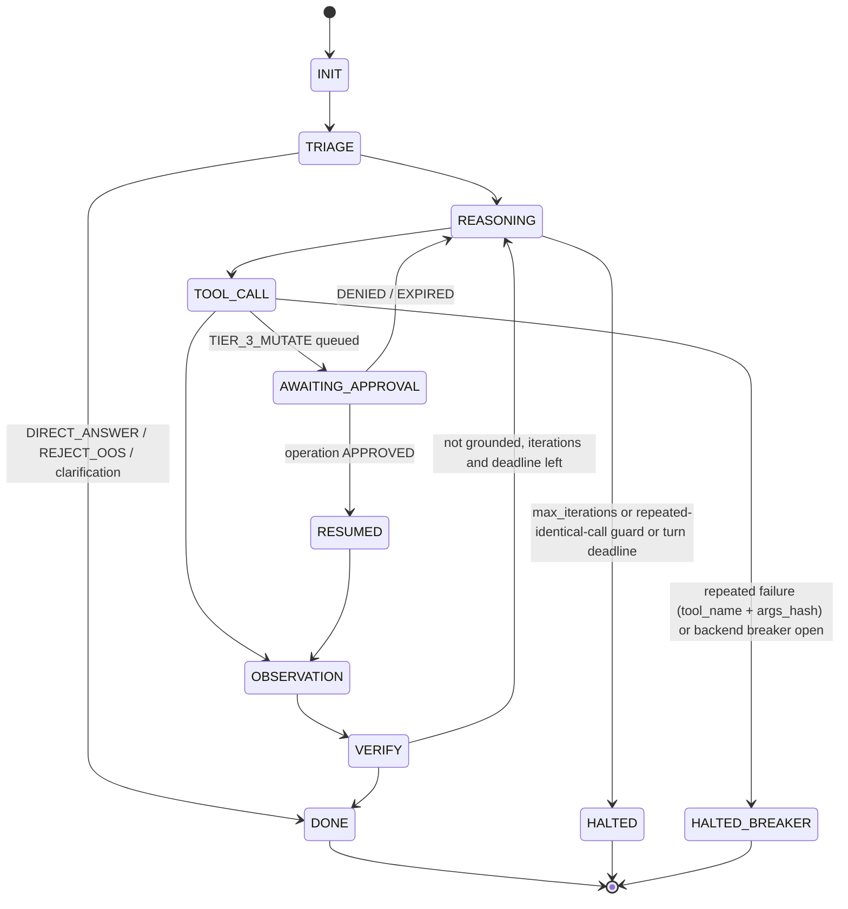
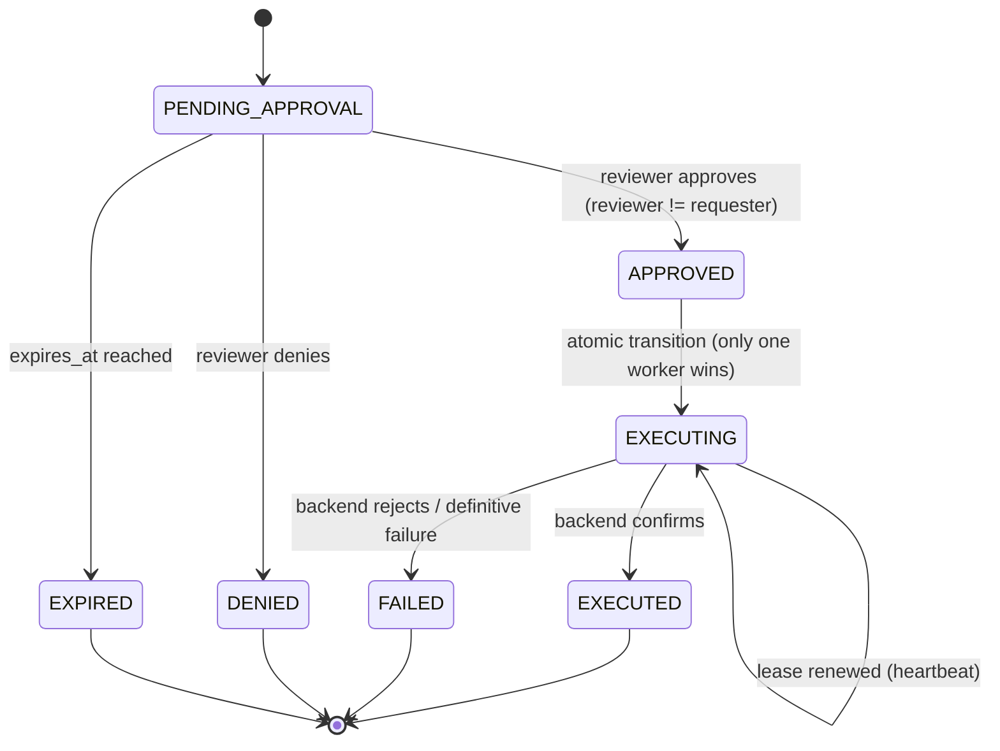
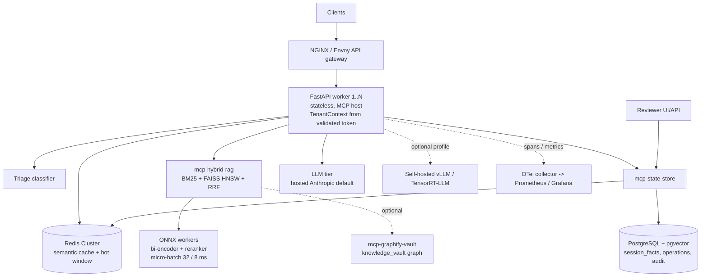

# System Specification — PwC One Assistant

Reference for `design.md`. Every figure here is **proposed** unless marked "user-specified"; targets must be validated by pilot and scale tests before they are claimed as results.

## 1.1 System charter & hard boundaries

- **Scope**: PwC One Assistant, an MCP-based agent platform that answers grounded questions (hybrid RAG) and, only through gated tools, performs actions on behalf of authenticated users. Hosted Anthropic inference is the default serving mode.
- **Non-goals**: zero autonomous clinical, financial or legal execution without human-in-the-loop (HITL) approval; no training/fine-tuning of the generation model; no end-user UI beyond the developer workbench (open item).
- **Personas**: end user (asks questions, requests actions), reviewer/approver (approves `TIER_3_MUTATE` operations), developer (workbench, tests, red team), platform operator (deploys, scales, watches KPIs), auditor (reads the hash-chained audit log).

## 1.2 MCP tool & data contracts

JSON-RPC 2.0 over MCP. Tool inputs/outputs are Pydantic v2 models with strict mode, regex constraints and bounds; invalid input is rejected (after a logged auto-repair attempt) before any backend call.

```python
from pydantic import BaseModel, Field, ConfigDict
from typing import Literal
from uuid import UUID

class Strict(BaseModel):
    model_config = ConfigDict(strict=True, extra="forbid", frozen=True)

class TenantContext(Strict):
    """Built ONLY from validated Entra ID token claims; never from request fields."""
    tenant_id: str           # from the token tenant claim (tid) mapped through the tenant registry
    user_id: str             # from the token object id claim (oid)
    roles: tuple[str, ...]   # from validated roles/groups claims
    permission_scope: str    # derived scope used in cache identity and authorization

class HybridRetrieveIn(Strict):
    query: str = Field(min_length=1, max_length=2000)
    # tenant is taken from TenantContext, not from this payload
    lexical_candidate_k: int = Field(default=50, ge=1, le=100)
    dense_candidate_k: int = Field(default=50, ge=1, le=100)
    ef_search: int = Field(default=64, ge=8, le=512)
    rrf_k: int = Field(default=60, ge=1, le=200)
    fused_k: int = Field(default=40, ge=1, le=100)
    output_k: int = Field(default=4, ge=1, le=10)
    min_score: float = Field(default=0.42, ge=0.0, le=1.0)   # reranker sigmoid space only
    bm25_k1: float = Field(default=1.25, ge=0.0, le=3.0)
    bm25_b: float = Field(default=0.75, ge=0.0, le=1.0)
    filters: dict[str, str] = {}

class Chunk(Strict):
    chunk_id: str
    chunk_hash: str
    text: str
    bm25: float | None = None            # BM25 score space
    cosine: float | None = None          # cosine similarity space
    fused_rank: int | None = None        # rank-based (RRF)
    rerank_score: float | None = None    # sigmoid in [0, 1]
    source_ref: str                      # note/document id + version

class HybridRetrieveOut(Strict):
    chunks: list[Chunk]                  # output_k verified chunks
    top_score: float                     # reranker sigmoid score of the best chunk
    abstain: bool                        # top_score < min_score

class WriteToolIn(Strict):               # template for any TIER_3_MUTATE tool
    operation_id: UUID                   # UUIDv4; idempotent only together with the uniqueness rule below
    entity_id: str                       # domain-specific regex per tool (example: ^SKU-\d{3}$)
    payload: dict

class GoalAnchorBlock(Strict):           # index 0 of every ReAct prompt
    original_intent: str
    entity_ids: tuple[str, ...]          # normalized (post auto-repair)
    policy_constraints: tuple[str, ...]

class TriageOut(Strict):
    intent: str
    domain: str
    risk_tier: Literal["TIER_1_READ", "TIER_2_COMPUTE", "TIER_3_MUTATE"]   # advisory only
    complexity: Literal["low", "medium", "high"]
    route: Literal["DIRECT_ANSWER", "HYBRID_RAG", "TRANSACTION_EXEC", "REJECT_OOS"]
    confidence: float = Field(ge=0.0, le=1.0)
```

Resources: `rag://chunks/{id}`. Tools: `hybrid_retrieve`, `rerank`, `state_get`, `state_put`, `audit_append`, `resolve_anchor`, `get_subgraph`.

| Code | Name | Meaning |
|---|---|---|
| -32602 | INVALID_PARAMS | Pydantic validation failed (after auto-repair attempt) |
| -32001 | TIER_DENIED | RBAC tier check failed |
| -32002 | DUPLICATE_OPERATION | `(tenant_id, operation_id)` already exists; stored result returned |
| -32003 | BREAKER_OPEN | Circuit breaker open (`HALTED_BREAKER`) |
| -32004 | APPROVAL_REQUIRED | `TIER_3_MUTATE` queued as `PENDING_APPROVAL` |
| -32005 | TIMEOUT | Stage, tool or turn deadline exceeded |
| -32006 | TENANT_MISMATCH | Resource tenant differs from `TenantContext` (HTTP 403) |
| -32007 | AUTH_FAILED | Token invalid/expired/unauthorized (HTTP 401/403 at the edge) |

Harness order: strict validation -> deterministic regex auto-repair -> RBAC tier check -> operation-ID/idempotency handling. Within the harness the plugins run `ambiguity_gate`, `idempotency_guard`, `circuit_breaker` in that order.

### Agent-turn state machine



`HALTED` = iteration/stall/repeated-call protection. `HALTED_BREAKER` = repeated-failure / circuit-breaker condition. Time spent in `AWAITING_APPROVAL` is excluded from the turn budget.

Harness budgets (proposed, until scale-tested):

```yaml
harness:
  max_iterations: 5
  total_turn_budget_ms: 2500
  timeouts: {state_ms: 100, retrieval_ms: 150, rerank_ms: 100, tool_read_ms: 500, tool_compute_ms: 1000, model_ms: 1500}
  approval: {excluded_from_turn_budget: true}
```

The per-operation timeouts are ceilings, not an allowance for every iteration to use all of them; the overall turn deadline binds.

### Durable operation state machine (Postgres)



Record: `operation_id` (UUIDv4), `tenant_id`, `session_id`, `tool_name`, `args_hash`, `args` (redacted), `requested_by`, `reviewer`, `status`, `created_at`, `decided_at`, `expires_at`, `execution_started_at`, `lease_expires_at`, `backend_idempotency_token`, `result_ref`. Rules:
- **`UNIQUE (tenant_id, operation_id)`**. UUIDv4 operation IDs combined with transactional uniqueness and atomic state transitions enforce idempotent execution; a UUID alone is not an exactly-once guarantee.
- Only an atomic `APPROVED -> EXECUTING` transition may win execution.
- `EXECUTING` holds a lease (`lease_expires_at`) renewed by heartbeat. A **reconciliation worker** handles expired leases: it queries the backend using the backend idempotency token where supported; if completion is uncertain it moves the operation to a **manual-review** state/queue. **Never auto-retry an irreversible write when completion is unclear.**
- Requester cannot approve their own operation; approvals expire; denied/expired operations never execute; repaired `TIER_3_MUTATE` values are shown to the approver. API: `POST /approvals/{id}/approve|deny` with reviewer role.

### Context retention records

`session_facts` (Postgres; tenant-scoped; written only after VERIFY; redacted, verified facts only; model speculation never enters):

| Column | Type |
|---|---|
| `session_id` | text |
| `fact_id` | uuid |
| `fact` | text (PII-redacted) |
| `source_ref` | text (note/doc id + version) |
| `verified_at` | timestamptz |
| `tenant_id` | text |
| `created_at` | timestamptz |

Hot window = last 3 ReAct turns in Redis/RAM. Anything needed after eviction must be in the immutable `GoalAnchorBlock` or in verified `session_facts`. `observation_max_tokens = 180` applies **only** to tool observations that re-enter the reasoning loop. Final grounded generation uses a separate `max_context_tokens`, which is model/profile dependent (open item).

### Semantic cache identity

```text
cache_identity = SHA256(tenant_id, dataset_version, normalized_intent,
                        normalized_entities, normalized_filters,
                        permission_scope, cache_schema_version)
```

Embedding similarity (>= 0.98) is evaluated only after the identity dimensions match; similarity alone is never sufficient. Invalidate entries on: dataset version change, source document version change, permission scope change, tenant membership/role change, relevant policy version change, `cache_schema_version` change. Entries hold normalized/redacted representations; keys are tenant-prefixed.

### Triage and routing

| Route | Path | Allowed tiers |
|---|---|---|
| `DIRECT_ANSWER` | LLM only | none (zero tool calls) |
| `HYBRID_RAG` | Retrieval Subagent -> Verification Subagent | `TIER_1_READ` |
| `TRANSACTION_EXEC` | Execution Subagent -> async HITL (if mutate) -> Verification Subagent | `TIER_2_COMPUTE`, `TIER_3_MUTATE` |
| `REJECT_OOS` | deterministic refusal | none |

Low confidence (`< triage.min_confidence`, 0.90 proposed until calibrated on the golden set): possibly transactional -> structured clarification; clearly non-mutating knowledge request -> read-only `HYBRID_RAG`; out-of-scope uncertainty -> clarification or `REJECT_OOS`. Never low confidence -> `TRANSACTION_EXEC`. The classifier's `risk_tier` is advisory; tool schema and RBAC are authoritative. Loop mapping: classifier = TRIAGE; Retrieval/Execution subagents act in TOOL_CALL; Verification Subagent = VERIFY.

### Circuit-breaker scopes

| Scope | Watches | Key | Outcome / config source |
|---|---|---|---|
| A. Loop/stall guard | repeated identical successful or low-progress calls | `max_identical_calls = 2` | `HALTED`; plugin config |
| B. Request-level failure breaker | repeated failures | `tool_name + canonical_args_hash` | `HALTED_BREAKER`; thresholds from `resilience.circuit_breaker` |
| C. Backend-health breaker | backend failure rate | server/service/endpoint identity (not arguments) | open/half-open states; `resilience.circuit_breaker` (failure threshold, recovery timeout, half-open calls) |

Scope C is keyed by backend identity so thousands of different argument sets do not each get their own breaker while the backend is broadly failing.

### Quality-gate relationships

| Component | Mode | Role |
|---|---|---|
| Verification Subagent | synchronous | blocking answer gate (claim-to-chunk NLI, veto) |
| `ragas_auditor` | asynchronous, sampled (`sample_rate` 0.1) | post-response monitoring/observability; cannot block |
| `model_fallback` | synchronous | escalate small -> large once when the synchronous gate fails; must still pass all plugins |
| Abstention | pre-generation | deterministic response when reranker top score < `min_score` (0.42) |

KPI-11/20/21/22 equal four of the five RAGAS release gates (precision, faithfulness, answer relevancy, entity recall); KPI-10 (Recall@50) is a retrieval measurement distinct from the Context Recall >= 0.85 release gate.

## 1.3 Distributed topology & data flow



Flow: gateway -> auth -> PRE plugins -> triage -> cache lookup (structural identity first) -> retrieval or execution -> LLM -> Verification Subagent -> POST plugins -> response. Cache keys are tenant-prefixed (`t:{tenant_id}:...`) and co-locate by tenant under Redis Cluster hash tags. Hosted mode: the provider owns inference infrastructure; the self-hosted profile is optional and separately sized.

## 1.4 Latency model and route-specific SLOs (proposed)

### Four distinct latencies

| Latency | From -> to |
|---|---|
| Request TTFT | request accepted -> first streamed response token |
| Model TTFT | LLM dispatch -> first model token |
| Retrieval latency | retrieval dispatch -> final reranked context |
| Transaction approval latency | human wait; **excluded** from runtime/turn latency |

There is no single universal end-to-end budget. Route-specific proposed engineering targets (not measured results):

| Route | Proposed target (p95) |
|---|---|
| `DIRECT_ANSWER` | <= 250 ms |
| Retrieval abstention | <= 200 ms |
| `HYBRID_RAG` | request TTFT <= 800 ms; completion <= 2500 ms |
| `TRANSACTION_EXEC` pre-approval | <= 1000 ms |
| HITL | approval wait excluded from execution-loop latency |

### Stage arithmetic per route (proposed, hosted default)

Common pre-model prefix: gateway + TLS 10 ms, pre-hook plugins 15 ms (KPI-01), triage 25 ms (KPI-05), semantic cache lookup 5 ms = **55 ms**.

Retrieval: lexical (30 ms ceiling) and dense (50 ms ceiling) run in parallel, then fusion 10 ms and rerank 60 ms: critical path max(30, 50) + 10 + 60 = **120 ms**; the retrieval deadline is **150 ms**, leaving ~30 ms for MCP serialization, task scheduling, context assembly, cancellation propagation and minor overhead. The stage ceilings are not summed serially. (Typical-path arithmetic from the stage budgets in KPI-07/08/09: 25 + 3 + 45 = 73 ms.)

| Route | Arithmetic | Note |
|---|---|---|
| `DIRECT_ANSWER` <= 250 | 55 prefix + model generation (~170) + verification/post (~25) | short answers only |
| Retrieval abstention <= 200 | 55 prefix + retrieval p95 <= ~145 ms (deadline 150) | tight: at the full 150 ms deadline this is 205 ms; the target assumes retrieval p95 stays below its deadline; validate in the pilot |
| `HYBRID_RAG` request TTFT <= 800 | 55 prefix + retrieval 150 + context assembly/graph ~15 + MCP ~8 => ~230 ms before the model; leaves ~570 ms for model TTFT (provider/model dependent) | model TTFT must be measured per profile |
| `HYBRID_RAG` completion <= 2500 | TTFT 800 + generation up to ~1500 (`model_ms`) + verification/post <= ~200 | turn deadline 2500 ms binds |
| `TRANSACTION_EXEC` pre-approval <= 1000 | 55 prefix + validation/state (<= 100 each) + tool_read/compute ceilings (500 / 1000) and the idempotency check | stops at `AWAITING_APPROVAL` |

### Historical note (why the old target was dropped)

An earlier draft kept one universal 450 ms end-to-end budget and a KPI-25 TTFT target of 180 ms measured from request start. The pre-LLM path alone was about 151 ms (gateway 10, pre-hooks 15, triage 25, cache 5, retrieval 73, MCP 8, context assembly 15), which left only about 29 ms for the model's first token. That is not a defensible assumption for a hosted LLM, so the budgets above are route-specific, TTFT is split into request vs model TTFT, and the approval wait is excluded. The 240/450/590 ms KPI-31..33 values now apply to the fast routes (see 1.5).

Micro-batch queue wait (`max_wait` 8 ms) counts inside the dense and rerank stage budgets. At low load it is pure added latency.

## 1.5 KPI & SLA gate matrix (36 KPIs; user-specified, re-scoped per route)

All 36 KPIs across 6 stages must be continuously measured and passed in CI/CD and workbench Tab 6; a KPI with no measurement source counts as not passed. There are exactly 36 KPI rows; route, provider and model-tier distinctions are **dimensions** of the same KPI id, not extra KPIs.

| Stage | KPI Name & Metric Definition | Target Threshold | Measurement Tool | Dimensions / notes |
|---|---|---|---|---|
| 1. Ingress & Triage | KPI-01: Pre-Hook Guardrail Latency (p95) | <= 15 ms | OTel Span `hook.pre` | |
| 1. Ingress & Triage | KPI-02: PII Redaction Recall (Email/Phone/SSN/Obfuscated) | >= 99.8% | Presidio / Regex Audit | test set must include obfuscated variants |
| 1. Ingress & Triage | KPI-03: Prompt Injection Block Rate (Direct + Indirect) | >= 99.5% | Red Team Benchmark | CI gate on the 100-prompt suite = 0 misses |
| 1. Ingress & Triage | KPI-04: Triage Routing Accuracy | >= 97.0% | Labeled Intent Set | also calibrates `min_confidence` |
| 1. Ingress & Triage | KPI-05: Triage Classification Latency (p95) | <= 25 ms | OTel Span `triage` | |
| 1. Ingress & Triage | KPI-06: False Positive Refusal Rate on Benign Queries | <= 1.0% | Benign Control Set | |
| 2. Hybrid Retrieval | KPI-07: Stage 1 BM25 Retrieval Latency (p95) | <= 12 ms | OTel Span `rag.bm25` | typical; stage ceiling 30 ms |
| 2. Hybrid Retrieval | KPI-08: Stage 2 Bi-Encoder + FAISS Latency (p95) | <= 25 ms | OTel Span `rag.dense` | typical; ceiling 50 ms; includes micro-batch wait |
| 2. Hybrid Retrieval | KPI-09: Stage 3 Cross-Encoder Rerank Latency (p95) | <= 45 ms | OTel Span `rag.rerank` | typical; ceiling 60 ms; includes micro-batch wait |
| 2. Hybrid Retrieval | KPI-10: Hybrid Context Recall@50 | >= 0.92 | RAGAS / IR Eval | retrieval measurement; distinct from the Context Recall release gate |
| 2. Hybrid Retrieval | KPI-11: Post-Rerank Context Precision@4 | >= 0.88 | RAGAS Evaluator | equals the Context Precision release gate |
| 2. Hybrid Retrieval | KPI-12: Mean Reciprocal Rank (MRR@4) | >= 0.85 | IR Benchmark Script | |
| 2. Hybrid Retrieval | KPI-13: Normalized Discounted Cumulative Gain (nDCG@4) | >= 0.86 | IR Benchmark Script | |
| 3. Agent & Loop | KPI-14: Tool Schema First-Pass Validation Rate | >= 96.0% | Pydantic Telemetry | |
| 3. Agent & Loop | KPI-15: Auto-Repair Success Rate on Malformed Args | >= 90.0% | Harness Metrics | |
| 3. Agent & Loop | KPI-16: Infinite Loop Escape Rate (Circuit Breaker) | 100.0% | Chaos Loop Suite | `HALTED` and `HALTED_BREAKER` |
| 3. Agent & Loop | KPI-17: Mean ReAct Steps per Completed Task | <= 2.2 steps | OTel Trace Count | limit is 5; this is the mean |
| 3. Agent & Loop | KPI-18: Context Drift Score (Goal Cosine Alignment) | >= 0.85 | Embedding Drift Audit | embedding model and window to be defined |
| 3. Agent & Loop | KPI-19: Tier 3 HITL Gate Enforcement Rate | 100.0% | Audit Log Integrity | |
| 4. Generation & RAGAS | KPI-20: RAGAS Faithfulness Score | >= 0.92 | Post-Hook RAGAS | release gate; async sampled in production |
| 4. Generation & RAGAS | KPI-21: RAGAS Answer Relevancy Score | >= 0.90 | Post-Hook RAGAS | release gate |
| 4. Generation & RAGAS | KPI-22: RAGAS Context Entity Recall | >= 0.85 | Post-Hook RAGAS | release gate |
| 4. Generation & RAGAS | KPI-23: Unanswerable Query Abstention Accuracy | >= 98.0% | Negative Test Set | |
| 4. Generation & RAGAS | KPI-24: Unsupported Claim / Hallucination Rate | <= 0.5% | NLI Claim Verifier | Verification Subagent |
| 4. Generation & RAGAS | KPI-25: Time-To-First-Token (TTFT p95) | Original user-specified <= 180 ms (from request start) is **re-scoped**: `HYBRID_RAG` request TTFT p95 <= 800 ms (proposed); model-TTFT threshold set from measured provider/model results (no assumed value) | FastAPI Stream Metric | dimensions: request_ttft, model_ttft, route, provider, model_tier |
| 5. Token & Graphify | KPI-26: Prompt Token Reduction via Graphify + Obsidian | >= 45.0% | Token Counter Hook | applies when Graphify is enabled; design goal 55% |
| 5. Token & Graphify | KPI-27: Semantic Cache Hit Ratio (Steady State) | >= 35.0% | Redis Hit/Miss Metric | requires a representative query mix |
| 5. Token & Graphify | KPI-28: Cross-Tenant Cache Isolation Integrity | 100.0% (0 leaks) | Concurrency Probe | explicit cross-tenant probes (token tenant A -> tenant B resource -> 403); does not rely on API echo |
| 5. Token & Graphify | KPI-29: Cost per 1,000 Enterprise Queries | <= $0.45 | OTel Token Cost Calc | depends on provider/model profile and mix; pricing basis open |
| 5. Token & Graphify | KPI-30: MCP JSON-RPC Serialization Overhead (p95) | <= 4 ms | MCP Client Timer | |
| 6. Scale & Load | KPI-31: End-to-End Response Latency (p50) | <= 240 ms (fast routes) | k6 + JMeter Summary | dimensions: `DIRECT_ANSWER`, retrieval abstention, semantic-cache hit (gates); `HYBRID_RAG` completion p50 TBD from pilot |
| 6. Scale & Load | KPI-32: End-to-End Response Latency (p95) | <= 450 ms (fast routes) | k6 + JMeter Summary | `HYBRID_RAG` completion p95 <= 2500 ms (proposed) |
| 6. Scale & Load | KPI-33: End-to-End Response Latency (p99) | <= 590 ms (< 600 ms) (fast routes) | k6 + JMeter Summary | `HYBRID_RAG` p99 TBD from pilot |
| 6. Scale & Load | KPI-34: HTTP 5xx / Error Rate | <= 0.05% | k6 / JMeter Threshold | at the arrival-rate test (8,500 RPS) |
| 6. Scale & Load | KPI-35: Sustained Throughput (Requests/Sec) | >= 8,500 RPS | k6 / JMeter Counter | offered via constant-arrival-rate; `maxVUs` up to 50,000 is a ceiling |
| 6. Scale & Load | KPI-36: Memory Leak / RSS Growth over 1-Hr Soak | <= 3.0% delta | Prometheus Node Exp | soak test D |

Notes: KPI-26 is the pass gate (>= 45%); the stack table's 55% is the design goal; the 320 vs 1,400 token figures are illustrative. Latency KPIs certify only in production-representative mode (`AUTH_ENABLED=true`). WER is conditional on the existence of voice/ASR input and is not part of the 36.

## 1.6 Failure mode & effects analysis (FMEA)

| # | Component failure | Detection | Effect | Deterministic fallback |
|---|---|---|---|---|
| 1 | Redis cluster down | health check, command timeout | no semantic cache, no hot window | bypass cache (reads), rebuild hot window from `session_facts`, never serve cross-tenant data |
| 2 | Reranker timeout | stage timeout, `rag.rerank` span | no precision rerank | return top RRF candidates marked low-confidence; abstain if below threshold semantics cannot be established |
| 3 | `mcp-hybrid-rag` crash | MCP ping / process exit | no retrieval | restart with backoff; backend breaker (scope C) opens; abstain/clarify with remediation prompt |
| 4 | Hosted LLM rate limit / overload (429) | provider HTTP 429, queue depth | generation delayed | bounded retry with jitter; one small<->large fallback; shed with 429 + `Retry-After`; platform rate limiting per tenant |
| 5 | Postgres failover | connection errors | state/audit writes fail | writes queue then fail closed for `TIER_3_MUTATE` (no unaudited mutations); reads from replica |
| 6 | `mcp-state-store` timeout | `timeout_ms` exceeded | no idempotency/approval check | block writes (fail closed), reads continue; `HALTED_BREAKER` after repeats |
| 7 | `mcp-graphify-vault` unavailable or anchor miss | MCP ping, anchor resolution result | no subgraph | fall back to Hybrid RAG chunks (never an empty context) |
| 8 | Prompt-injection hit | `injection_shield` verdict | possible goal hijack | block + audit event; indirect hits quarantine the source note/chunk |
| 9 | Auth/JWKS failure | token validation error, JWKS fetch failure | cannot verify identity | fail closed 401/403; cached JWKS only within TTL; production start fails if auth disabled |
| 10 | Cache poisoning / tenant leak | isolation probe (KPI-28), key audit | wrong data served | structural cache identity, tenant-prefixed keys, purge namespace, disable cache until probe passes |
| 11 | HITL approval timeout | `expires_at` reached | pending mutation stalled | mark `EXPIRED`, notify requester, no execution |
| 12 | Loop / retry storm | loop guard, breaker, `max_iterations`, turn deadline | resource exhaustion | `HALTED` / `HALTED_BREAKER` + structured remediation prompt; bulkheads protect health checks |
| 13 | Worker crash while `EXECUTING` | lease expiry (`lease_expires_at`) | operation outcome unknown | reconciliation worker checks the backend via the backend idempotency token; if uncertain -> manual review; never auto-retry an irreversible write |

## 1.7 Architecture decision records

### ADR-001 Model serving
*Context*: Anthropic models cannot run on vLLM/TensorRT-LLM; the earlier text mixed them. *Decision*: `model_serving.mode: hosted` (provider: anthropic) is the default; `self_hosted.enabled: false` is an optional profile (vLLM/TensorRT-LLM, continuous batching, prefix caching, GPU sizing). Small/large models are configurable via `<MODEL_TIERS>`. *Consequences*: hosted mode puts inference scheduling/batching with the provider; the platform owns concurrency limits, rate limiting, retries, cache, fallback and observability. KPI-25 and KPI-29 depend on the provider/model profile and on measurements. Exact model names and pricing basis are open.

### ADR-002 Latency semantics
*Context*: one 450 ms budget and 120 ms per-step timeout were incompatible with hosted LLM latency. *Decision*: four latency concepts (request TTFT, model TTFT, retrieval latency, approval latency); route-specific proposed SLOs; per-operation timeouts with an overall turn deadline; approval wait excluded. *Consequences*: KPI-25 and KPI-31..33 are scoped by route; all values stay proposed until measured.

### ADR-003 Retrieval semantics
*Context*: `top_k`, `rerank_top_k` and `minimum_score` meant different things in different docs. *Decision*: BM25 `candidate_k` 50 and Dense `candidate_k` 50 -> RRF `fused_k` 40 -> reranker `output_k` 4 (`min_score` 0.42) -> `max_context_chunks` 4; `ef_search` 64; `rrf_k` 60. BM25, cosine, RRF and sigmoid scores are separate spaces. Retrieval deadline 150 ms with stage ceilings 30/50/10/60 ms; MCP timeout 30 s is only a catastrophic ceiling. *Consequences*: one abstention threshold; the old `minimum_score: 0.7` is removed.

### ADR-004 Identity & tenancy
*Decision*: Entra ID validated token claims produce `TenantContext`; request-supplied tenant fields are not trusted; `security.authentication.enabled` resolves from `AUTH_ENABLED` (strict boolean); production + `AUTH_ENABLED != true` fails startup. All isolation (DB, Redis keys, cache, MCP calls, audit, `session_facts`, approvals) inherits `TenantContext`. *Open*: role vs group, single vs multi-tenant app registration.

### ADR-005 Transaction semantics
*Decision*: UUIDv4 operation IDs + `UNIQUE (tenant_id, operation_id)` + atomic state transitions + async HITL; separate agent-turn and durable-operation state machines; lease/heartbeat, reconciliation and manual review for `EXECUTING`. *Consequences*: a UUID is not claimed to give exactly-once by itself; irreversible writes are not auto-retried when completion is uncertain.

### ADR-006 Load model
*Decision*: certify on arrival rate (8,500 RPS via constant-arrival-rate); 50,000 VUs is a `maxVUs` ceiling, not an offered-rate definition. Four test types: smoke, load/capacity, tenant isolation/security, soak. Capacity sizing is derived from pilots (baseline -> pilot -> RPS/replica -> replicas + 30-50% headroom -> certification -> tune -> repeat). *Illustration*: L = lambda x W; 8,500 RPS x 0.240 s ~ 2,040 in flight (illustrative).

### ADR-007 Persistent data classification
*Decision*: explicit redaction, retention, tenant isolation and audit handling per store (table below). Hash chaining alone is not immutability; it needs append-only/restricted writer permissions, ordering semantics, verification and external/trusted anchoring or an equivalent protection against privileged rewriting. Anchoring technology and manifest signing scheme are open.

| Store | Contents | Redaction / retention (proposed) | Isolation |
|---|---|---|---|
| Raw requests | user messages | not persisted by default; if policy requires, redacted/hashed with a short TTL | tenant-scoped |
| `session_facts` | verified facts | redacted verified facts only; retention per policy (TBD) | `tenant_id` column + query filter |
| Redis / semantic cache | normalized representations, hot window | normalized/redacted; TTL (`ttl_seconds`) | `t:{tenant_id}:` prefix, identity hash |
| Postgres (state, operations) | operations, approvals | `args` redacted; retention per policy (TBD) | `tenant_id` in every query |
| Audit chain | event metadata + `payload_hash` | no raw sensitive payload; retention per compliance (TBD) | per-tenant chain scope (TBD) |
| OTel / logs | spans, logs | no sensitive payloads or tokens; `log_sensitive_data: false` | tenant attribute only |
| `second-brain/` | project/dev/session knowledge | PII-free; not served to production retrieval | separate scope |
| `knowledge_vault/` | enterprise knowledge notes | PII-free notes with versions | tenant/ACL policy (open) |

### ADR-008 Hybrid retrieval weights
BM25 (k1 1.25, b 0.75) and dense (HNSW, `ef_search` 64) fused with RRF (`rrf_k` 60); tunable via the catalog keys. Robust to score-scale differences; reranker adds latency; tune against KPI-10..13.

### ADR-009 ONNX quantization
Bi-encoder and reranker run as ONNX (FP16 reranker; INT8 where accuracy holds) with micro-batching (batch 32, max wait 8 ms counted inside stage budgets). Re-measure KPI-10/11 after quantization.

### ADR-010 Redis key isolation
Keys are prefixed `t:{tenant_id}:` with the tenant in the cluster hash tag; cache hits require the structural identity (entity/filter/dataset/permission scope/schema version) before similarity. Probed by KPI-28; may lower the hit ratio (KPI-27).

### ADR-011 Bounded ReAct loops
Deterministic agent-turn state machine with `max_iterations` 5, differentiated per-operation timeouts, an overall turn deadline, a loop/stall guard (`HALTED`) and failure/backend breakers (`HALTED_BREAKER`). Replaces the earlier single per-step timeout and 450 ms loop budget.

## Capacity sizing process

1. Deploy a baseline (no assumed counts). 2. Run a controlled pilot. 3. Measure sustainable RPS per replica per route. 4. Calculate the required replicas for the target arrival rate. 5. Add 30-50% operational headroom. 6. Run the certification test. 7. Tune/autoscale. 8. Repeat. Any numeric example in the docs is illustrative. Replica counts, GPU type/count (self-hosted profile only), Redis shards, autoscaling thresholds and injector counts are not asserted; the bulkhead pool totals (448 workers) are not evidence of 50K capacity.
