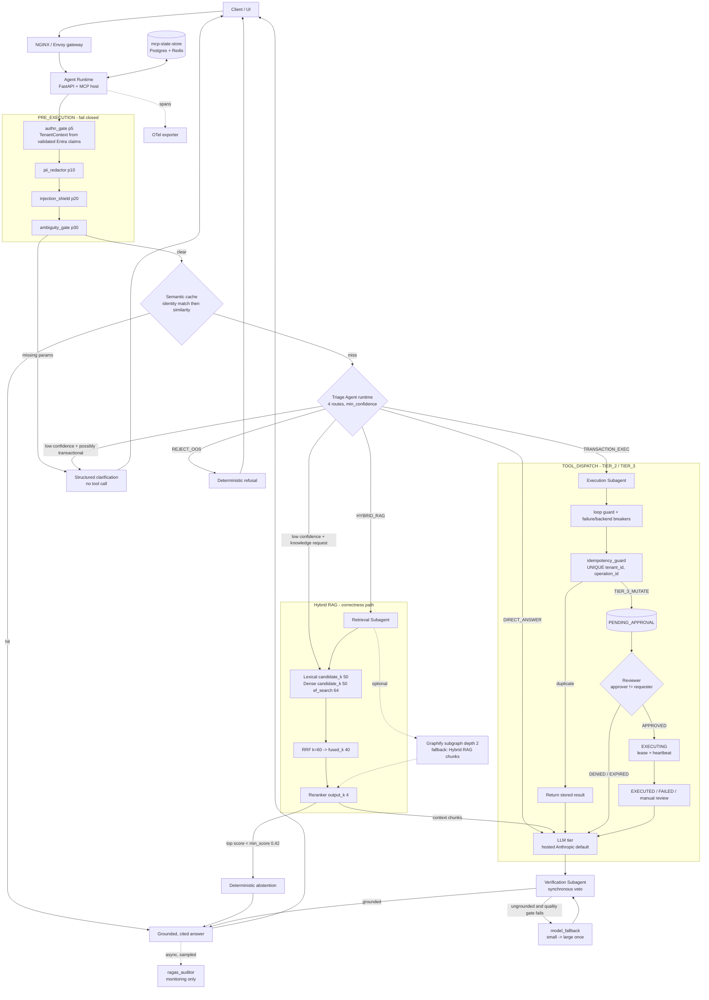
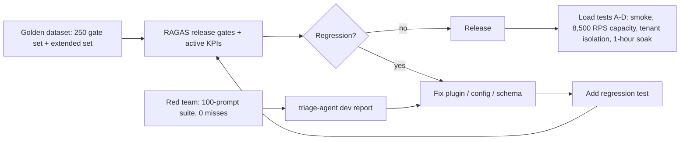

# Request Workflow

Mermaid below is the **source of truth** for the workflow. `docs/workflow-diagram.png` was drawn by hand before the architecture reconciliation (runtime triage, async approval, verification gate, optional Graphify) and is **stale: regeneration pending**. No Mermaid renderer is installed in this environment, so the PNG was not regenerated; do not treat it as current. Interactive knowledge graph of the docs: `graphify-out/graph.html`.

## Request flow

Notes: the agent turn pauses in `AWAITING_APPROVAL` while the durable operation waits in `PENDING_APPROVAL`; that wait is excluded from turn latency. `HALTED` (loop guard) and `HALTED_BREAKER` (failure/backend breaker) end the turn with a structured remediation prompt. Hybrid RAG still returns grounded results when Graphify is disabled or fails.

## Quality and security loop

